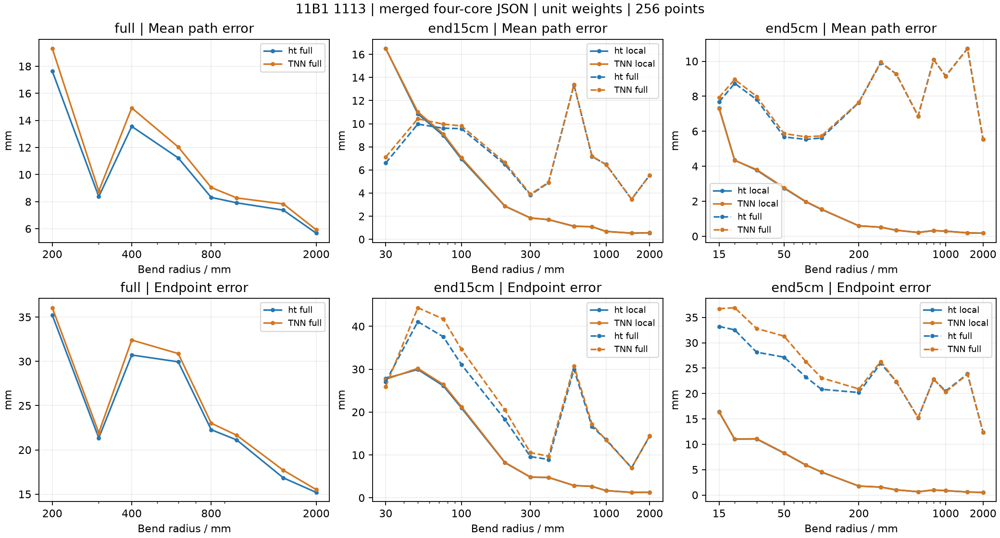

# 11B1四芯共同项b模型合并参数静态重建

使用 `params/11B1_NeTi_four_core_b_merged.json`，自由外包圆圆心，ch1 相对同一圆心比其他芯更靠近中心。数据使用全部半径及0°/120°/240°，未拟合或加载weight；256点、vector_pchip、3点向量移动滤波、rot_ang=0。

|弯曲区域|评价范围|积分器|评价长度/mm|工况数|平均形状误差/mm|平均末端误差/mm|平均曲率相对误差|
|---|---|---|---:|---:|---:|---:|---:|
|full|full|ht|919.0|24|10.0096|24.0835|22.50%|
|full|full|TNN|919.0|24|10.7672|24.8958|22.50%|
|end15cm|local|ht|150.0|36|4.4771|11.0379|25.68%|
|end15cm|local|TNN|150.0|36|4.5109|11.1008|25.68%|
|end15cm|full|ht|919.0|36|7.2468|21.2689|25.68%|
|end15cm|full|TNN|919.0|36|7.4059|22.5203|25.68%|
|end5cm|local|ht|50.0|42|1.7405|4.6460|35.31%|
|end5cm|local|TNN|50.0|42|1.7426|4.6495|35.31%|
|end5cm|full|ht|919.0|42|7.8763|23.4574|35.31%|
|end5cm|full|TNN|919.0|42|7.9583|25.0880|35.31%|

形状误差先按每工况沿曲线对应弧长点计算欧氏距离均值，再对工况等权平均；末端误差亦按工况等权平均。local 仅评价末端弯曲局部，full 使用全部有效WL重建整根光纤，并以“前段直线＋末端圆弧”为理想形状。不同评价长度的绝对误差不直接横向比较。

full校准数据的重建使用的是最终合并参数，因此末端WL会采用局部标定参数，结果不等于单独全段JSON回代。

所有数据均来自校准数据集，属于同批数据回代，不是独立精度验证。本次未验证真实动态设备。

各region/scope/integrator子目录包含逐工况误差、逐WL曲率、三维重建路径和运行配置。

## 按评价长度归一化的相对误差

形状相对误差=平均形状误差/评价长度；末端相对误差=平均末端误差/评价长度。以下百分比均采用对应评价范围长度，曲率相对误差沿用逐工况相对理想曲率的平均值。

|测试区域|评价范围|积分器|长度/mm|形状相对误差|末端相对误差|曲率相对误差|
|---|---|---|---:|---:|---:|---:|
|full|full|ht|919|1.09%|2.62%|22.50%|
|full|full|TNN|919|1.17%|2.71%|22.50%|
|end15cm|local|ht|150|2.98%|7.36%|25.68%|
|end15cm|local|TNN|150|3.01%|7.40%|25.68%|
|end15cm|full|ht|919|0.79%|2.31%|25.68%|
|end15cm|full|TNN|919|0.81%|2.45%|25.68%|
|end5cm|local|ht|50|3.48%|9.29%|35.31%|
|end5cm|local|TNN|50|3.49%|9.30%|35.31%|
|end5cm|full|ht|919|0.86%|2.55%|35.31%|
|end5cm|full|TNN|919|0.87%|2.73%|35.31%|

## 分方向相对误差

各方向内按半径工况等权平均。形状和末端相对误差均除以对应评价长度。

|测试区域|评价范围|积分器|方向|工况数|形状/mm|末端/mm|形状相对误差|末端相对误差|曲率相对误差|
|---|---|---|---:|---:|---:|---:|---:|---:|---:|
|end15cm|full|TNN|0|12|8.21|26.67|0.89%|2.90%|30.25%|
|end15cm|full|TNN|120|12|6.83|22.85|0.74%|2.49%|25.72%|
|end15cm|full|TNN|240|12|7.18|18.04|0.78%|1.96%|21.08%|
|end15cm|full|ht|0|12|8.00|24.97|0.87%|2.72%|30.25%|
|end15cm|full|ht|120|12|6.72|21.44|0.73%|2.33%|25.72%|
|end15cm|full|ht|240|12|7.02|17.39|0.76%|1.89%|21.08%|
|end15cm|local|TNN|0|12|4.36|10.33|2.91%|6.89%|30.25%|
|end15cm|local|TNN|120|12|3.86|10.21|2.57%|6.81%|25.72%|
|end15cm|local|TNN|240|12|5.31|12.76|3.54%|8.51%|21.08%|
|end15cm|local|ht|0|12|4.32|10.21|2.88%|6.80%|30.25%|
|end15cm|local|ht|120|12|3.73|10.03|2.48%|6.69%|25.72%|
|end15cm|local|ht|240|12|5.38|12.87|3.59%|8.58%|21.08%|
|end5cm|full|TNN|0|14|7.19|26.65|0.78%|2.90%|33.51%|
|end5cm|full|TNN|120|14|8.09|21.90|0.88%|2.38%|49.08%|
|end5cm|full|TNN|240|14|8.60|26.71|0.94%|2.91%|23.35%|
|end5cm|full|ht|0|14|7.09|24.72|0.77%|2.69%|33.51%|
|end5cm|full|ht|120|14|8.03|20.47|0.87%|2.23%|49.08%|
|end5cm|full|ht|240|14|8.51|25.17|0.93%|2.74%|23.35%|
|end5cm|local|TNN|0|14|2.20|5.86|4.40%|11.73%|33.51%|
|end5cm|local|TNN|120|14|1.44|4.17|2.89%|8.34%|49.08%|
|end5cm|local|TNN|240|14|1.58|3.91|3.16%|7.83%|23.35%|
|end5cm|local|ht|0|14|2.18|5.82|4.36%|11.64%|33.51%|
|end5cm|local|ht|120|14|1.47|4.21|2.94%|8.42%|49.08%|
|end5cm|local|ht|240|14|1.57|3.90|3.15%|7.81%|23.35%|
|full|full|TNN|0|8|11.26|22.39|1.23%|2.44%|22.65%|
|full|full|TNN|120|8|14.90|35.29|1.62%|3.84%|28.13%|
|full|full|TNN|240|8|6.14|17.00|0.67%|1.85%|16.71%|
|full|full|ht|0|8|10.26|20.88|1.12%|2.27%|22.65%|
|full|full|ht|120|8|14.08|33.79|1.53%|3.68%|28.13%|
|full|full|ht|240|8|5.69|17.58|0.62%|1.91%|16.71%|
