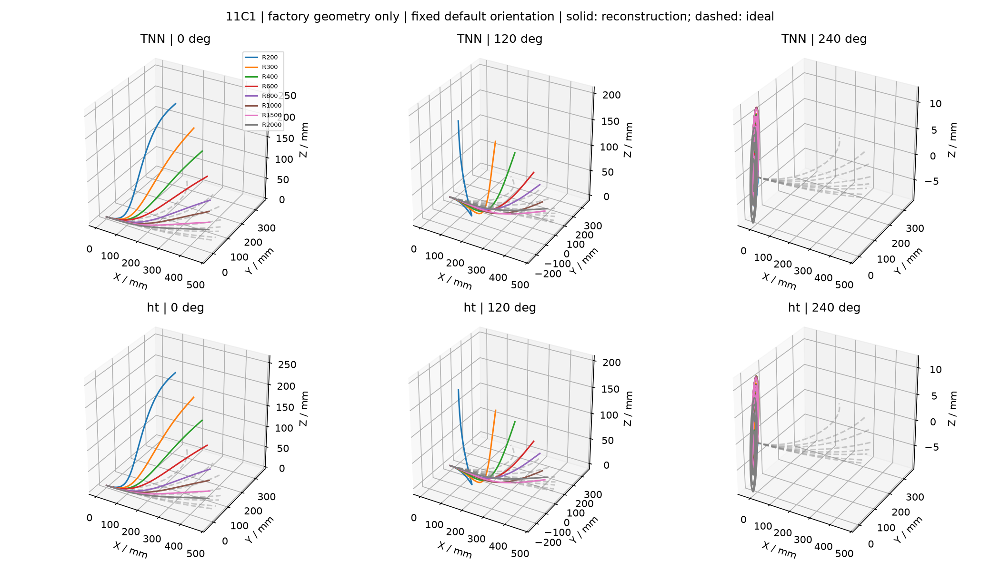

# 11C1 出厂芯位直接重建（不校准）

CH1固定原点，CH2/CH3/CH4半径分别41.43/41.88/41.31 μm，各截面统一角度0°/120°/240°（项目alpha约定）。整体朝向和手性均沿用项目默认，不从数据拟合。出厂距离及夹角没有确定相对夹具的绝对朝向，因此结果依赖此朝向假设；无逐截面转角校准。

外芯减CH1消除公共响应，再用固定出厂芯位最小二乘计算曲率；无四芯+b芯位拟合，无weight优化或拟合灵敏度。有效灵敏度沿用1 pm/με假设。纤芯半径9 μm仅用于物理非重叠判断，不是弯曲力臂。12/13峰逐帧对齐规则不变，输入为波长变化量，不二次减零。

475.25 mm、24工况、256点vector_pchip、3点向量滤波。

            states  mean_shape_mm  mean_endpoint_mm  worst_endpoint_mm
integrator                                                            
TNN             24     148.727086        316.353469         620.844536
ht              24     149.034164        317.106218         621.206476

与此前factory_fixed不同：此前仍拟合了截面转角及选择镜像顺序，本次完全没有。

