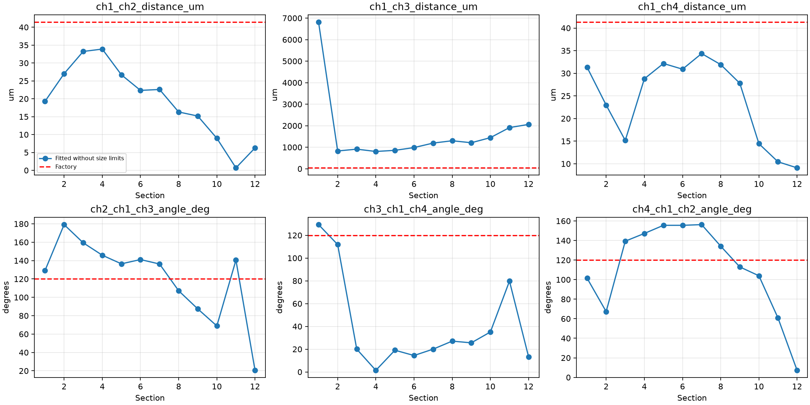

# 11C1 出厂几何核对

出厂CH1-CH2=41.43 μm、CH1-CH3=41.88 μm、CH1-CH4=41.31 μm，三个外芯相对CH1互成120°。

size_unconstrained取消旧拼束模型的外包圆尺寸及芯间不重叠限制，仅保留CH1最靠近某一可行包络圆心的条件。JSON中350/50为旧接口占位参数，size_constraint_mode=none时不作为尺寸约束使用。出厂尺寸未输入此组拟合，灵敏度仍假设1 pm/με。比较全部使用CH1到外芯的相对向量，不能把四芯质心坐标下的r直接当作该距离。

                                                     mean     minimum      maximum  mean_abs_difference
model                  metric                                                                          
factory_fixed          ch1_ch2_distance_um      41.430000   41.430000    41.430000         5.329071e-15
                       ch1_ch3_distance_um      41.880000   41.880000    41.880000         3.552714e-15
                       ch1_ch4_distance_um      41.310000   41.310000    41.310000         4.144833e-15
                       ch2_ch1_ch3_angle_deg   120.000000  120.000000   120.000000         2.605323e-14
                       ch3_ch1_ch4_angle_deg   120.000000  120.000000   120.000000         4.144833e-14
                       ch4_ch1_ch2_angle_deg   120.000000  120.000000   120.000000         3.552714e-14
old_bundle_constraints ch1_ch2_distance_um     100.000000  100.000000   100.000000         5.857000e+01
                       ch1_ch3_distance_um     243.000170  227.978815   249.999910         2.011202e+02
                       ch1_ch4_distance_um     127.767676  100.000000   183.303028         8.645768e+01
                       ch2_ch1_ch3_angle_deg    75.278912   66.373299    90.650439         4.472109e+01
                       ch3_ch1_ch4_angle_deg    65.361101   62.900844    67.072260         5.463890e+01
                       ch4_ch1_ch2_angle_deg    96.421822   23.578178   132.843643         4.070304e+01
size_unconstrained     ch1_ch2_distance_um      19.376494    0.695979    33.895443         2.205351e+01
                       ch1_ch3_distance_um    1692.616570  802.772688  6813.035520         1.650737e+03
                       ch1_ch4_distance_um      24.113591    9.099079    34.359879         1.719641e+01
                       ch2_ch1_ch3_angle_deg   120.991056   20.516335   179.159926         3.366051e+01
                       ch3_ch1_ch4_angle_deg    41.410506    1.391766   129.365015         8.015033e+01
                       ch4_ch1_ch2_angle_deg   111.821989    7.199098   156.272760         3.620755e+01

factory_fixed严格固定出厂相对几何，只拟合各截面整体转角及选择镜像顺序。这组吻合出厂值是输入约束的结果，不是校准独立恢复了出厂值。

                        states  mean_shape_mm  mean_endpoint_mm  worst_endpoint_mm
model                                                                             
factory_fixed               24     113.467973        262.477426         485.729843
old_bundle_constraints      24     127.061473        283.747752         519.341069
size_unconstrained          24      80.917035        230.292056         531.882860

重建均为同批24工况回代，475.25 mm，TNN，单位weight，256点vector_pchip，3点向量滤波；不二次减零。原始数据和其他传感器默认约束不变。

结论：旧100 μm最小芯间距与出厂约41 μm中心外芯距离矛盾，应对11C1停用。去除尺寸约束后，数据拟合的三个中心外芯距离均值为19.38、1692.62、24.11 μm，并未恢复出厂几何；固定出厂几何后误差仍大。单独更换几何约束不足以解释当前波长响应，需要继续核查CH3参考波长、峰切换、灵敏度及装夹方向。这里是异常线索，不是对原因的确定诊断。

