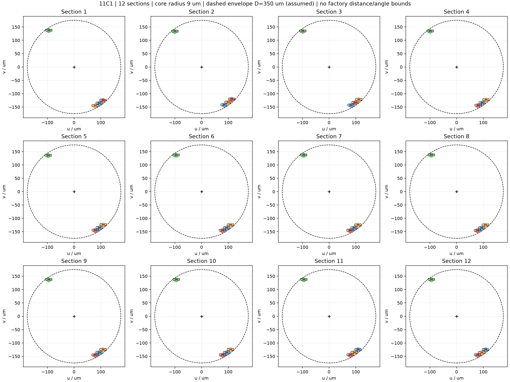

# 11C1 原形式约束，纤芯半径9 μm

去掉出厂距离±5%和夹角±5°限制。原形式约束：纤芯半径9 μm，任意芯间距≥18 μm；沿用外包圆直径350 μm试算假设，芯中心到同一可行圆心≤166 μm；圆心自由，CH1距离该圆心不大于各外芯。350 μm不是已知实测包层直径。

截面图以各截面的可行外包圆圆心为原点，彩色圆为半径9 μm的纤芯，虚线为假设外包圆；不是显微照片，圆心也不是独立测量的真实圆心。未施加120°或41 μm距离限制。

            states  mean_shape_mm  mean_endpoint_mm  worst_endpoint_mm
integrator                                                            
TNN             24      87.132065        218.596878         430.712733
ht              24      86.011198        217.921490         432.254693

同批24工况回代；单位weight，475.25 mm，256点vector_pchip，3点向量滤波。

注意：CH3与其他三芯分离，CH1–CH3距离约331～332 μm，接近允许的极限332 μm。这是数据与当前模型下的受约束拟合结果，不是出厂几何被恢复。
