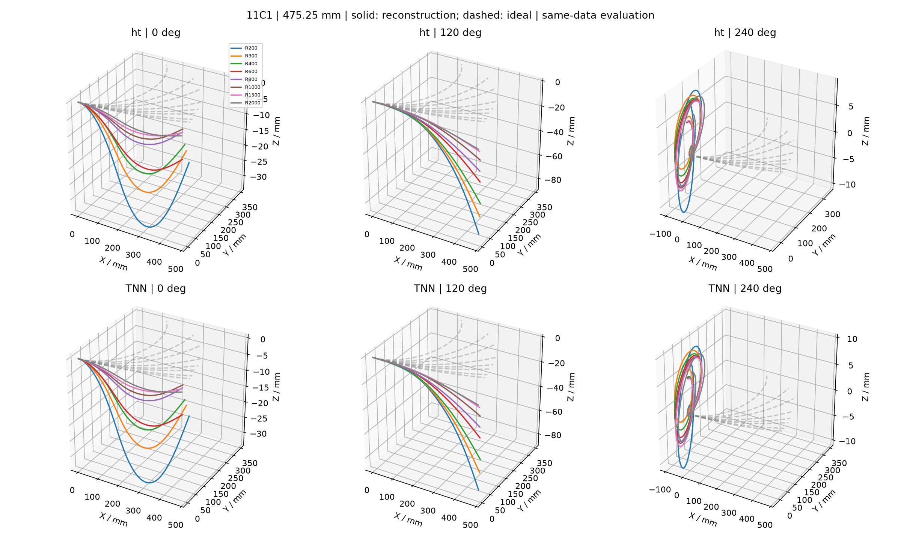

# 11C1 正交校准与重建

逐帧判断：有WL13时取WL2～WL13，只有WL12时取WL1～WL12，预处理副本统一编号为截面1～12；原始文件不修改。CH1为中心芯，CH2/3/4为外芯。输入为波长变化量，不二次减零；R=0不参与拟合。

start=19.25 mm，end=6 mm，全长475.25 mm。按现有Sensor点序约定，预设位置间距倒序累计，详见section_mapping.csv。R=41.5 μm保存在硬件参数中；正交法拟合实际芯位，不把R固定为校准结果。当前物理约束沿用项目默认外径350 μm、单芯半径50 μm，灵敏度1 pm/με，非本次实测值。

三方向×8半径=24工况，使用同批数据校准及回代，不能当作独立验证。四芯共同项模型schema 6，单位weight，无weight优化；vector_pchip，256点，3点向量滤波。

            states  mean_shape_mm  mean_endpoint_mm  worst_endpoint_mm
integrator                                                            
TNN             24     127.061473        283.747752         519.341069
ht              24     128.348161        286.090018         524.919447

平均拟合残差：1933.5250 pm。

形状误差：对应弧长采样点的欧氏距离均值；末端误差：末端欧氏距离。表中各工况等权平均。详见all_errors.csv、by_direction.csv、by_radius.csv。

复现：python tools/run_11c1_orthogonal.py

当前结果误差较大，240°最突出，不能视为校准成功或可用精度。对齐后CH3在240°、R200工况第1截面的波长变化均值约32246 pm，平均校准残差约1934 pm；需进一步检查原始波长参考与峰切换连续性。仅按授权规则对齐，未修改波长基准或补偿这些偏置。逐截面输入均值和标准差见input_section_statistics.csv。
